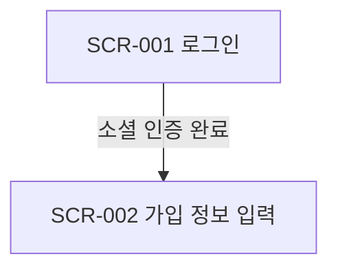

# 화면 이동 흐름 (Screen Flows): {project_name}

기획의 User Flow(`04-user-flows.md`)를 화면 단위로 옮깁니다. 기획의 모든 FLOW 단계(대안·오류 경로 포함)가 아래 대응표에 있어야 합니다.

## FLOW-001: (기획의 FLOW 제목)

### FLOW 단계 → 화면 대응

| FLOW 단계 | 화면·상태 | 비고 |
|---|---|---|
| FLOW-001-S1 | SCR-001, SCR-002 | |
| FLOW-001-S1a | SCR-002-ST3 | 입력 오류 |

## 전역 이동

| 출발 | 조건 | 도착 |
|---|---|---|
| 모든 보호 화면 | 로그아웃 상태 | SCR-001 |
