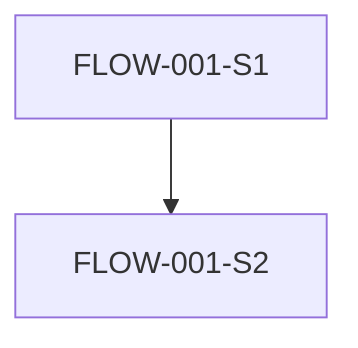

# 사용자 플로우 (User Flows): {{product_name}}

<!-- 작성 가이드(산출물에서는 이 주석을 삭제합니다)
     - 텍스트 중심으로 작성합니다. 화면 디자인은 여기서 하지 않습니다(Milestone 2).
     - 모든 US는 1개 이상의 FLOW에 나타나거나 'UI 플로우가 없는 스토리' 섹션에 있어야 합니다. -->

## FLOW-001: {{플로우 이름}}

- **행위자**: PER-001
- **커버하는 스토리**: US-001
- **진입 조건**:
- **종료 / 성공 상태**:

| 단계 | 사용자 행동 | 시스템 반응 |
|---|---|---|
| FLOW-001-S1 | | |
| FLOW-001-S2 | | |

**대안 / 오류 경로**

- FLOW-001-S2a:

## UI 플로우가 없는 스토리 (Stories without UI flow)

<!-- 예: 백그라운드 작업. US ID와 이유를 적거나, 없으면 "없음"이라고 씁니다. -->
